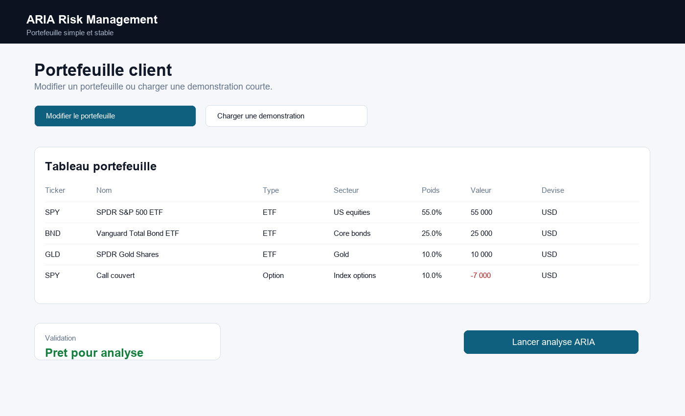
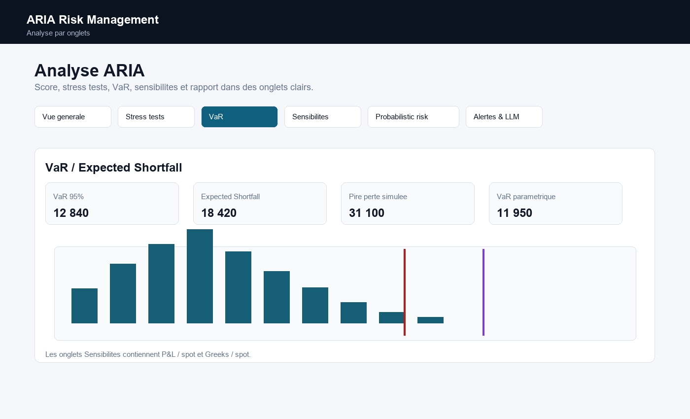
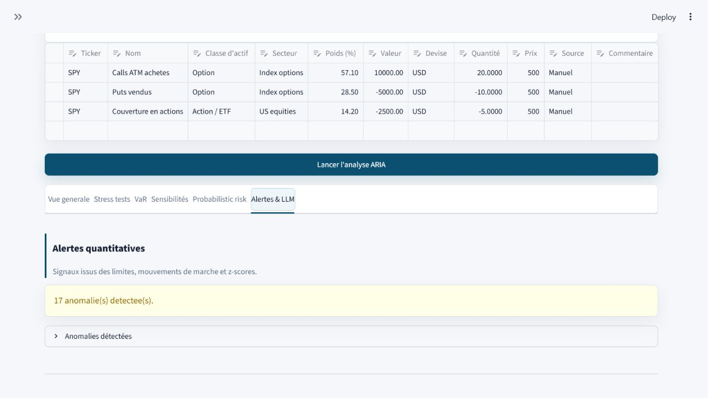

# ARIA - Adaptive Risk Intelligence Agent

ARIA est une application Streamlit simple pour presenter une analyse de risque
de portefeuille en entretien finance.

Projet developpe par **Enrique Jara Ron**.

> Prototype educatif. Les resultats ne constituent pas un conseil en
> investissement et ne garantissent aucune performance future.

## Ce que fait ARIA

- Composer ou modifier un portefeuille actions / ETF / options.
- Charger un portefeuille de demonstration propre.
- Valider les champs essentiels avant analyse.
- Lancer une analyse de risque lisible.
- Consulter les resultats par onglets :
  - Vue generale et score de risque ;
  - Stress tests ;
  - VaR / Expected Shortfall ;
  - Sensibilites : P&L par rapport au spot et evolution des Greeks ;
  - Risque probabiliste ;
  - Alertes, commentaire LLM optionnel et rapport PDF.

## Portefeuilles de demonstration

L'interface garde seulement quatre exemples utiles :

- `Conservative Balanced Portfolio` ;
- `Global Diversified Portfolio` ;
- `Tech Growth Portfolio` ;
- `Covered Call`.

## Captures

### Portefeuille



### Analyse ARIA



### Stress tests


### Rapport



## Installation

```powershell
python -m venv .venv
.\.venv\Scripts\Activate.ps1
python -m pip install --upgrade pip
pip install -r requirements.txt
```

## Lancement

```powershell
streamlit run streamlit_app.py
```

Ou :

```powershell
streamlit run streamlit_app.py --server.port 8502
```

## API / LLM

Le commentaire LLM est optionnel. En local, copier `.env.example` vers `.env` :

```powershell
Copy-Item .env.example .env
```

Exemple :

```text
OPENAI_API_KEY=sk-...
ARIA_LLM_MODEL=gpt-5-mini
```

Sans API, ARIA reste utilisable pour l'analyse quantitative.

## Streamlit Cloud

- Repository : `Enrique-JaraRon/ARIA`
- Branch : `main`
- Main file path : `streamlit_app.py`

Secrets optionnels :

```toml
OPENAI_API_KEY = "sk-..."
ARIA_LLM_MODEL = "gpt-5-mini"
```

## Qualite

```powershell
.\.venv\Scripts\python.exe quality_check.py
```
