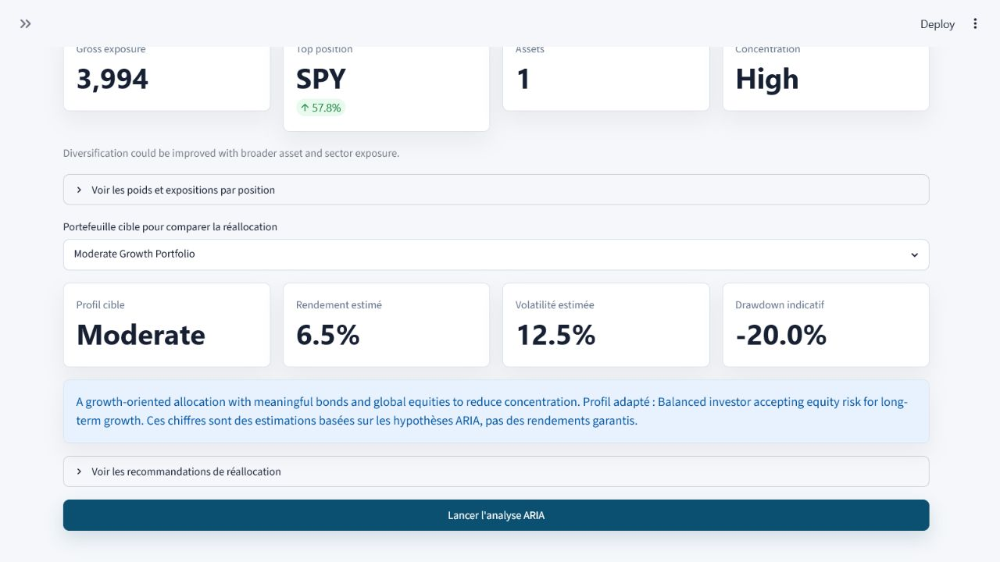
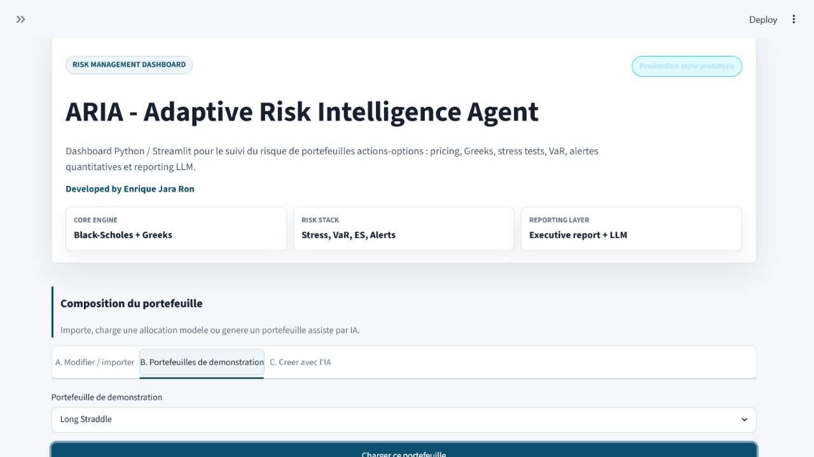

# ARIA - Adaptive Risk Intelligence Agent

ARIA is a Python / Streamlit risk management dashboard for equity and option
portfolios. It is designed as a clean educational prototype of a trading-floor
risk monitoring tool: transparent enough to study, but structured enough to be
presented in a GitHub portfolio, CV or quantitative finance interview.

Developed by **Enrique Jara Ron**.

## Overview

ARIA lets a user build an option portfolio, price positions with Black-Scholes,
aggregate Greeks, run stress tests, estimate VaR / Expected Shortfall, detect
quantitative anomalies, generate a global risk score and download an executive
risk report with optional LLM commentary.

The project intentionally keeps quantitative logic in dedicated Python modules
and keeps the Streamlit app focused on orchestration and visualization.

## Main Features

- European call and put pricing with Black-Scholes.
- Delta, Gamma, Theta, Vega, Rho, Vanna and Volga aggregation.
- Long and short option / stock positions with contract multipliers.
- Standard and custom stress scenarios.
- Stylized historical crisis stress scenarios inspired by 2008, Covid,
  yen-carry unwind, inflation shock, rates shock, tech sell-off, volatility
  spike and banking stress.
- Multi-underlying portfolio tables with per-line spot and volatility.
- Portfolio CSV save / load workflow for reusable books.
- Spot / volatility risk surface.
- P&L profile and breakeven estimation.
- Greeks profile across spot levels.
- Monte Carlo VaR and Expected Shortfall.
- Simplified parametric VaR estimate.
- ARIA Risk Score from 0 to 100.
- Quantitative anomaly detection on Greeks, market moves and historical z-scores.
- Delta hedge recommendation.
- Institutional alerts for concentration, scenario loss, drawdown and
  correlation convergence risk.
- Modular market data providers: Manual, Yahoo Finance, CSV and optional Bloomberg.
- Demo option strategies and realistic books ready to load in the dashboard:
  tech options book, hedged equity portfolio, volatility book and
  crisis-sensitive portfolio.
- Professional stock / ETF model portfolios for conservative, growth,
  defensive, ESG, inflation-aware, AI / semiconductor and global core profiles.
- Guided AI portfolio builder with validation, duplicate ticker merging,
  weight normalization to 100% and an automatic fallback when no API key is
  configured.
- Downloadable executive Markdown and PDF risk reports.
- Optional LLM-based risk commentary.
- Automated tests, Ruff linting and project diagnostics.

## Screenshots / Usage

### Dashboard Overview


### Portfolio Analysis


### Model Portfolios



### Stress Testing


### Probabilistic Risk Analysis


### Risk Report


### Rebalancing Recommendations



## Portfolio Analytics

ARIA now includes a more professional portfolio workflow designed for a private
banking / advisory-style first risk review:

- three clear workflows: manual import / edit, demo portfolio loading and
  AI-assisted portfolio creation;
- stable manual portfolio editor backed by `st.session_state` with technical
  legacy columns hidden from the user interface;
- clear distinction between `stock` and `option` rows;
- stock rows require ticker, quantity, price, currency and optional sector;
- option rows require underlying, option type, strike, maturity, volatility,
  rate, quantity and contract size;
- automatic validation with explicit error messages;
- current exposure table with gross weights and net weights;
- concentration diagnosis;
- sector / asset diversification view;
- comparison against a target model portfolio;
- rebalancing table showing current weight, target weight and amount to
  reduce or increase;
- recommendations phrased as risk-management actions, not direct investment
  orders.
- generated portfolios are validated before being loaded into ARIA: duplicate
  tickers are merged, weights are normalized to 100% and unrealistic outputs are
  corrected or replaced by a diversified fallback.

The analytics engine does not promise returns. Expected return, volatility,
drawdown and diversification scores are model assumptions intended to guide
discussion and risk monitoring.

## Demo And Model Portfolios

ARIA includes ready-to-load option strategies:

- Long Straddle
- Short Straddle
- Bull Call Spread
- Bear Put Spread
- Protective Put
- Covered Call

These strategies can be loaded from the Streamlit interface and then edited
manually in the portfolio table.

ARIA also includes professional stock / ETF model allocations:

- Conservative Balanced Portfolio
- Moderate Growth Portfolio
- Global Diversified Portfolio
- Tech Growth Portfolio
- Defensive Dividend Portfolio
- Hedged Equity Portfolio
- Low Volatility Portfolio
- Crisis-Resilient Portfolio
- ESG Sustainable Portfolio
- AI & Semiconductors Portfolio
- European Quality Portfolio
- US Blue Chips Portfolio
- Global ETF Core Portfolio
- Inflation Protection Portfolio
- Long-Term Compounders Portfolio

Each model portfolio includes target weights, estimated return, estimated
volatility, indicative drawdown, diversification score and a plain-English
investor profile.

## AI Portfolio Builder

The "Creer avec l'IA" tab helps a user build a personalized simulation before
launching the normal ARIA analysis. The form captures horizon, risk level,
preferred instruments, style, geography, sectors to include or avoid, names to
include or exclude and simulated portfolio size.

When `OPENAI_API_KEY` and `ARIA_LLM_MODEL` are configured, ARIA asks the LLM for
a structured JSON portfolio. When the API is unavailable, ARIA uses a controlled
local fallback so demonstrations still work. In both cases the output is
validated before use:

- required fields: ticker, name, weight, asset class and sector;
- no negative weights;
- duplicate tickers merged;
- weights normalized to 100%;
- concentration reduced when a generated position is excessive;
- educational disclaimer displayed before loading into the app.

The generated allocation can be loaded into the portfolio editor or launched
directly through the standard ARIA workflow: exposure, Greeks, VaR, stress
tests, alerts, LLM report and PDF exports.

## Market Data Architecture

ARIA supports several market data modes:

| Provider | Purpose | Notes |
|---|---|---|
| Manual | Fully local mode | User enters spot and volatility manually. |
| Yahoo Finance | Demo / public market data | Default online provider via `yfinance`. |
| CSV local | Offline reproducible data | Reads local price history from CSV. |
| Bloomberg optional | Professional integration placeholder | Requires Bloomberg Terminal/API and `blpapi`; not required by ARIA. |

Bloomberg is intentionally optional. The project does not install or require
Bloomberg dependencies, and it remains fully functional with Manual, Yahoo
Finance or CSV data.

## Executive Risk Report

The downloadable Markdown / PDF report is structured as a professional
internal-style risk note. Streamlit provides three exports: Markdown, French
PDF and English PDF.

- Executive Summary
- Market Context
- Portfolio Overview
- Risk Score Interpretation
- Greeks Exposure
- Stress Test Analysis
- VaR / Expected Shortfall Analysis
- Delta Hedging Recommendation
- Key Risk Drivers
- Quantitative Alerts
- LLM Risk Commentary at the beginning of the PDF
- Concrete risk-management action plan with model-based quantities when
  available
- Limitations and Model Assumptions
- Appendix with the key figures to remember

The LLM does not calculate risk metrics and must not invent figures. It only
comments on ARIA outputs and includes model limitations.

LLM commentary is controlled from the Streamlit sidebar. By default, ARIA keeps
the dashboard in local commentary mode to avoid unwanted API calls during tests
or demonstrations.

When enabled, the LLM is instructed to clearly explain actions that could be
studied to reduce risk while improving the risk-adjusted return profile, such as
delta hedging, reducing concentrated Greeks, rebalancing volatility exposure or
using option spreads. These outputs remain risk-management commentary, not
personalized financial advice.

## Project Structure

```text
ARIA/
|-- streamlit_app.py
|-- ui_components.py
|-- pricing_BS.py
|-- portfolio.py
|-- scenario_analysis.py
|-- risk_surface.py
|-- pnl_profile.py
|-- greeks_profile.py
|-- var_analysis.py
|-- risk_score.py
|-- hedging_analysis.py
|-- anomaly_detector.py
|-- risk_history.py
|-- history_analytics.py
|-- market_data.py
|-- demo_portfolios.py
|-- portfolio_analytics.py
|-- report_generator.py
|-- llm_explainer.py
|-- app_config.py
|-- aria_workflow.py
|-- project_diagnostics.py
|-- quality_check.py
|-- tests: test_*.py
|-- docs/
|   `-- screenshots/
|-- screenshots/
`-- data/
```

## Installation

Create and activate a virtual environment, then install dependencies:

```powershell
python -m venv .venv
& .\.venv\Scripts\Activate.ps1
python -m pip install --upgrade pip
python -m pip install -r requirements.txt
```

## Environment Variables

LLM commentary is optional. Copy `.env.example` to `.env` locally and configure
placeholders only on your machine:

```text
OPENAI_API_KEY=your_openai_api_key_here
ARIA_LLM_MODEL=gpt-4.1-mini
```

Never commit `.env` or real API keys.

## Run the App

Easiest local launch on Windows:

```powershell
start_aria.bat
```

The launcher starts Streamlit on port `8502`, prints the computer URL and prints
the phone URL for the same Wi-Fi network:

- Computer: `http://localhost:8502`
- Phone: `http://<your-computer-ip>:8502`

For phone presentation, keep the computer and phone on the same Wi-Fi, allow
Python/Streamlit through Windows Firewall if prompted, then open the printed
phone URL in the mobile browser.

Equivalent manual command:

```powershell
& C:/Users/enriq/OneDrive/Bureau/ARIA/ARIA/.venv/Scripts/python.exe -m streamlit run streamlit_app.py --server.address 0.0.0.0 --server.port 8502 --server.headless true
```

You can change the port before launching:

```powershell
$env:ARIA_STREAMLIT_PORT="8503"
start_aria.bat
```

LLM / API mode works when `.env` contains `OPENAI_API_KEY` and
`ARIA_LLM_MODEL`, then the LLM commentary is enabled from the Streamlit sidebar.

## Present as an Application

For a simple portfolio or interview demo, run `start_aria.bat` and present the
browser tab in full screen on the computer or phone. For a real hosted web app,
deploy the repository to Streamlit Community Cloud or another Python hosting
service, install `requirements.txt`, and configure secrets there instead of
committing `.env`.

## Run Tests

```powershell
& C:/Users/enriq/OneDrive/Bureau/ARIA/ARIA/.venv/Scripts/python.exe -m pytest -v
```

## Run the Full Quality Check

```powershell
& C:/Users/enriq/OneDrive/Bureau/ARIA/ARIA/.venv/Scripts/python.exe c:/Users/enriq/OneDrive/Bureau/ARIA/ARIA/quality_check.py
```

The quality check runs:

- Ruff linting
- Pytest
- Project diagnostics

## Limitations

- Black-Scholes assumptions are simplified and do not cover all market regimes.
- VaR / Expected Shortfall are simplified Monte Carlo estimates.
- Stress tests are deterministic scenarios, not market forecasts.
- Market data quality depends on the selected provider.
- Delta hedge recommendations are indicative and ignore transaction costs,
  liquidity, gamma, vega and operational constraints.
- The LLM commentary is explanatory and must not be treated as financial advice.

## Possible Improvements

- Add historical backtesting workflows.
- Add richer CSV schemas with bid / ask and implied volatility.
- Add an implemented Bloomberg adapter for an environment with Bloomberg access.
- Add authentication and persistent user configuration.

## CV Line

Built ARIA, a Python/Streamlit risk management dashboard for option portfolios
with Black-Scholes pricing, Greeks aggregation, stress testing, VaR, anomaly
detection, modular market data providers and LLM-based risk reporting.
