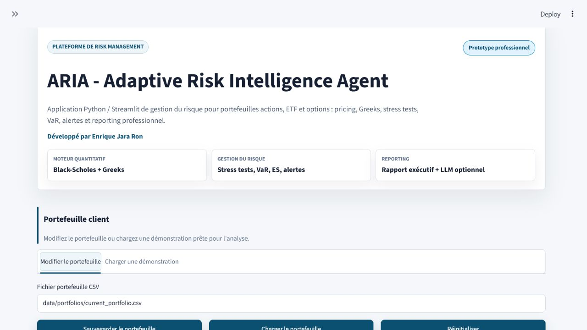
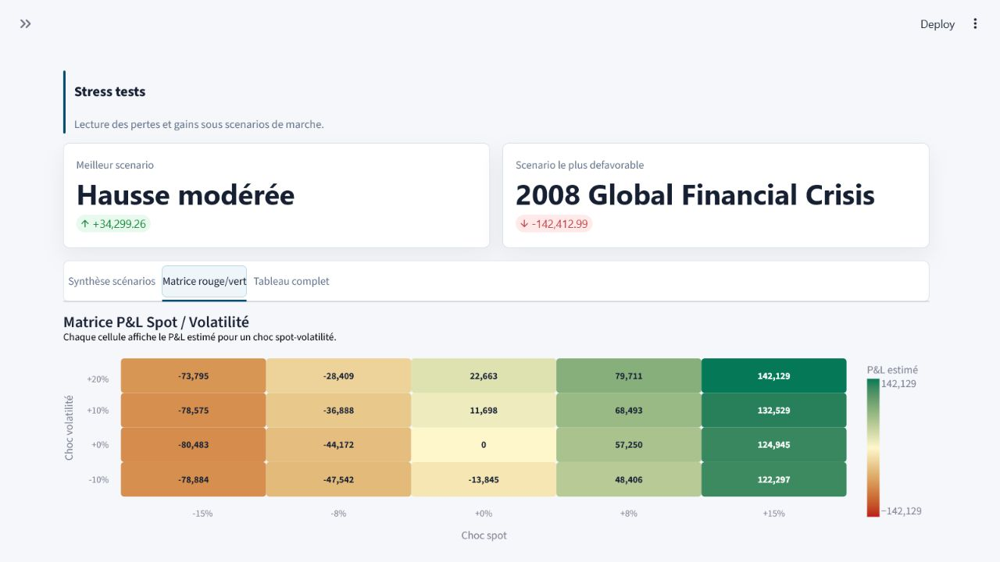
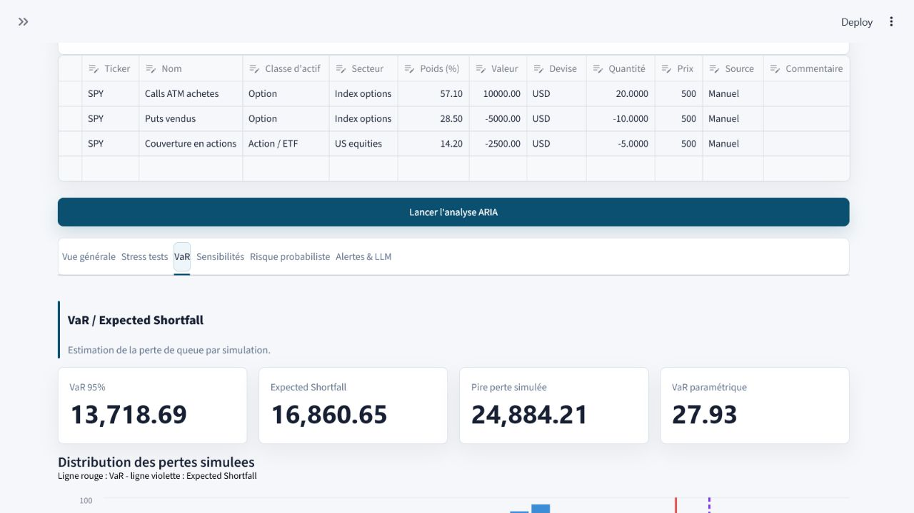
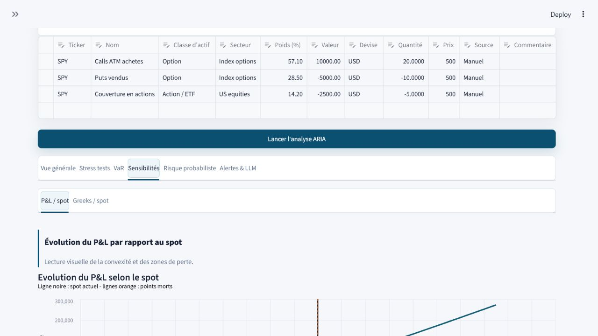
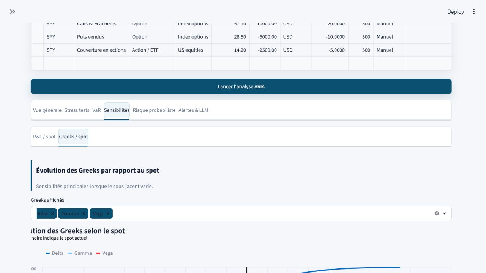
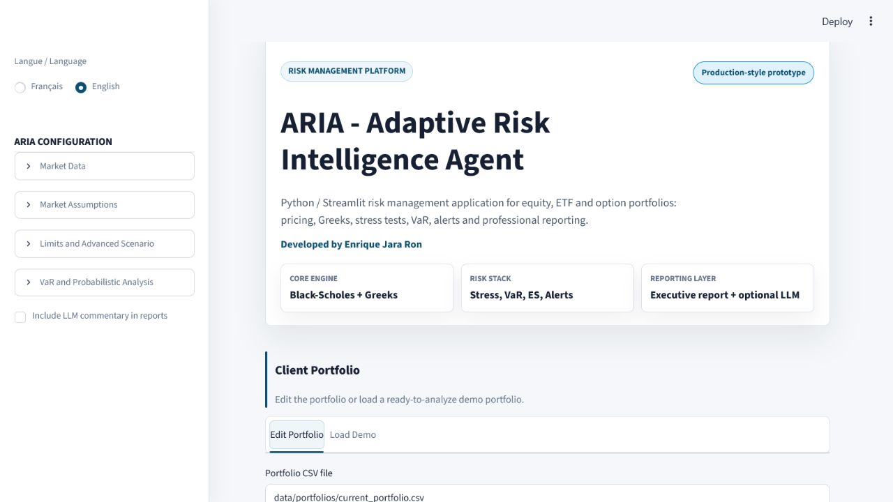

# ARIA - Adaptive Risk Intelligence Agent

ARIA est une application Streamlit de risk management pour portefeuilles
actions, ETF et options. Elle est pensee pour une demonstration claire en
entretien : composition du portefeuille, controles de coherence, stress tests,
VaR, Greeks, analyse probabiliste et rapport PDF professionnel.

Projet developpe par **Enrique Jara Ron**.

> Prototype educatif. Les resultats ne sont pas un conseil financier et ne
> garantissent pas une performance future.

## Ce que fait ARIA

- Creation ou chargement d'un portefeuille client.
- Portefeuilles de demonstration utiles : prudent, diversifie, croissance tech,
  options faible risque.
- Pricing Black-Scholes, Greeks et sensibilites au spot.
- Stress tests historiques et matrice spot / volatilite.
- VaR, Expected Shortfall et analyse Monte Carlo.
- Donnees de marche par sous-jacent avec historique, volatilite et correlation.
- Alertes quantitatives et commentaire LLM optionnel.
- Rapport PDF premium avec page de garde, graphiques integres et annexe.
- Interface en francais avec bouton pour passer toute l'application en anglais.

## Captures de l'application

### Portefeuille client



### Score de risque


### Stress tests


### Matrice rouge / vert



### VaR et Expected Shortfall



### Sensibilites P&L



### Evolution des Greeks



### Risque probabiliste


### Rapport executif


### Mode anglais



## Donnees de marche

ARIA fonctionne en mode manuel pour rester stable hors ligne. Pour une analyse
plus realiste, l'application peut aussi charger des donnees Yahoo Finance ou un
CSV local.

Le moteur construit alors :

- un historique par sous-jacent ;
- les rendements journaliers ;
- la volatilite annualisee ;
- la matrice de correlation ;
- une calibration plus robuste du risque probabiliste.

Format CSV accepte :

```csv
Date,Ticker,Close
2026-01-02,SPY,500.0
2026-01-02,QQQ,430.0
2026-01-03,SPY,504.0
2026-01-03,QQQ,435.0
```

## Rapport PDF

Le rapport telechargeable est construit comme une note de risk management :

- page de garde ARIA ;
- explication simple pour un client non expert ;
- synthese decisionnelle ;
- plan d'action de reduction du risque ;
- historique marche et correlation ;
- stress tests, VaR, Expected Shortfall et Greeks ;
- annexe avec les chiffres importants.

Le PDF est disponible en francais et en anglais depuis l'application.

## Installation

```powershell
python -m venv .venv
.\.venv\Scripts\Activate.ps1
python -m pip install --upgrade pip
pip install -r requirements.txt
```

## Lancement local

```powershell
streamlit run streamlit_app.py
```

Ou sur le port utilise en demonstration :

```powershell
streamlit run streamlit_app.py --server.port 8502
```

Mode anglais direct :

```text
http://localhost:8502/?lang=en
```

## API / LLM

Le LLM est optionnel. Sans cle API, ARIA reste utilisable pour toute l'analyse
quantitative.

Creer un fichier `.env` local a partir de `.env.example` :

```powershell
Copy-Item .env.example .env
```

Exemple :

```text
OPENAI_API_KEY=sk-...
ARIA_LLM_MODEL=gpt-5-mini
```

## Streamlit Cloud

- Repository : `Enrique-JaraRon/ARIA`
- Branch : `main`
- Main file path : `streamlit_app.py`

Secrets optionnels :

```toml
OPENAI_API_KEY = "sk-..."
ARIA_LLM_MODEL = "gpt-5-mini"
```

## Structure

```text
app/                Interface, configuration, LLM et reporting
portfolio_engine/   Portefeuilles, instruments, pricing et donnees marche
risk_engine/        Stress tests, VaR, Greeks, probabilites et score
tests/              Tests unitaires et controles quantitatifs
tools/              Diagnostic et controle qualite
scripts/            Scripts de lancement local
screenshots/        Captures utilisees dans ce README
```

## Qualite

```powershell
.\.venv\Scripts\python.exe -m pytest -q
.\.venv\Scripts\python.exe -m ruff check .
```
