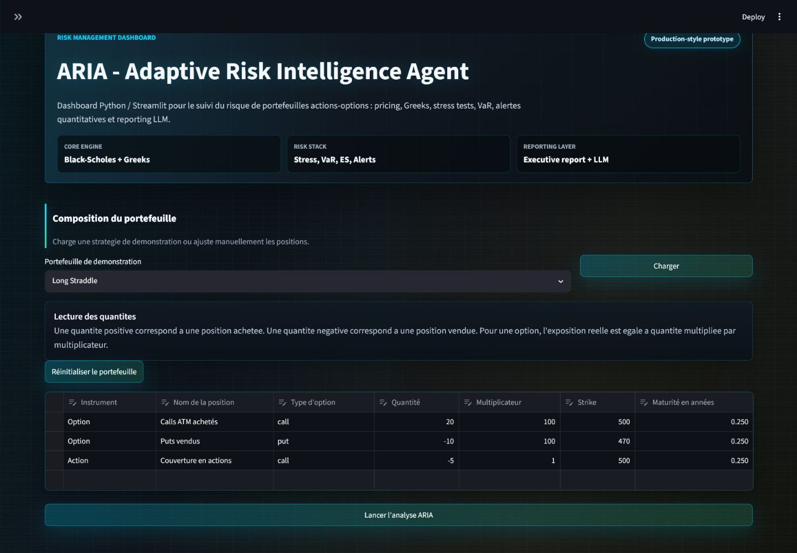
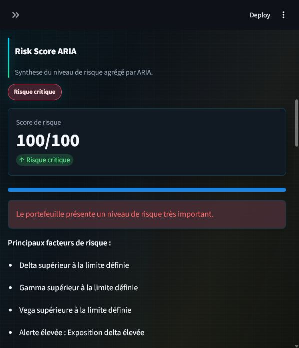

# ARIA - Adaptive Risk Intelligence Agent

ARIA is a Python / Streamlit risk management dashboard for equity and option
portfolios. It is designed as a clean educational prototype of a trading-floor
risk monitoring tool: transparent enough to study, but structured enough to be
presented in a GitHub portfolio, CV or quantitative finance interview.

## Overview

ARIA lets a user build an option portfolio, price positions with Black-Scholes,
aggregate Greeks, run stress tests, estimate VaR / Expected Shortfall, detect
quantitative anomalies, generate a global risk score and download an executive
risk report with optional LLM commentary.

The project intentionally keeps quantitative logic in dedicated Python modules
and keeps the Streamlit app focused on orchestration and visualization.

## Main Features

- European call and put pricing with Black-Scholes.
- Delta, Gamma, Theta, Vega, Rho, Vanna and Volga aggregation.
- Long and short option / stock positions with contract multipliers.
- Standard and custom stress scenarios.
- Spot / volatility risk surface.
- P&L profile and breakeven estimation.
- Greeks profile across spot levels.
- Monte Carlo VaR and Expected Shortfall.
- Simplified parametric VaR estimate.
- ARIA Risk Score from 0 to 100.
- Quantitative anomaly detection on Greeks, market moves and historical z-scores.
- Delta hedge recommendation.
- Modular market data providers: Manual, Yahoo Finance, CSV and optional Bloomberg.
- Demo option strategies ready to load in the dashboard.
- Downloadable executive Markdown risk report.
- Optional LLM-based risk commentary.
- Automated tests, Ruff linting and project diagnostics.

## Screenshots / Usage

Screenshots will be added after final UI polishing.

### Dashboard Overview



### Stress Testing



### Risk Report


## Demo Portfolios

ARIA includes ready-to-load option strategies:

- Long Straddle
- Short Straddle
- Bull Call Spread
- Bear Put Spread
- Protective Put
- Covered Call

These strategies can be loaded from the Streamlit interface and then edited
manually in the portfolio table.

## Market Data Architecture

ARIA supports several market data modes:

| Provider | Purpose | Notes |
|---|---|---|
| Manual | Fully local mode | User enters spot and volatility manually. |
| Yahoo Finance | Demo / public market data | Default online provider via `yfinance`. |
| CSV local | Offline reproducible data | Reads local price history from CSV. |
| Bloomberg optional | Professional integration placeholder | Requires Bloomberg Terminal/API and `blpapi`; not required by ARIA. |

Bloomberg is intentionally optional. The project does not install or require
Bloomberg dependencies, and it remains fully functional with Manual, Yahoo
Finance or CSV data.

## Executive Risk Report

The downloadable Markdown report is structured as an internal-style risk note:

- Executive Summary
- Market Context
- Portfolio Overview
- Risk Score Interpretation
- Greeks Exposure
- Stress Test Analysis
- VaR / Expected Shortfall Analysis
- Delta Hedging Recommendation
- Key Risk Drivers
- Quantitative Alerts
- LLM Risk Commentary
- Limitations and Model Assumptions
- Recommended Next Actions

The LLM does not calculate risk metrics and must not invent figures. It only
comments on ARIA outputs and includes model limitations.

## Project Structure

```text
ARIA/
|-- streamlit_app.py
|-- ui_components.py
|-- pricing_BS.py
|-- portfolio.py
|-- scenario_analysis.py
|-- risk_surface.py
|-- pnl_profile.py
|-- greeks_profile.py
|-- var_analysis.py
|-- risk_score.py
|-- hedging_analysis.py
|-- anomaly_detector.py
|-- risk_history.py
|-- history_analytics.py
|-- market_data.py
|-- demo_portfolios.py
|-- report_generator.py
|-- llm_explainer.py
|-- aria_workflow.py
|-- project_diagnostics.py
|-- quality_check.py
|-- tests: test_*.py
|-- docs/
|   `-- screenshots/
`-- data/
```

## Installation

Create and activate a virtual environment, then install dependencies:

```powershell
python -m venv .venv
& .\.venv\Scripts\Activate.ps1
python -m pip install --upgrade pip
python -m pip install -r requirements.txt
```

## Environment Variables

LLM commentary is optional. Copy `.env.example` to `.env` locally and configure
placeholders only on your machine:

```text
OPENAI_API_KEY=your_openai_api_key_here
ARIA_LLM_MODEL=gpt-4.1-mini
```

Never commit `.env` or real API keys.

## Run the App

```powershell
& C:/Users/enriq/OneDrive/Bureau/ARIA/ARIA/.venv/Scripts/python.exe -m streamlit run streamlit_app.py
```

or:

```powershell
start_aria.bat
```

## Run Tests

```powershell
& C:/Users/enriq/OneDrive/Bureau/ARIA/ARIA/.venv/Scripts/python.exe -m pytest -v
```

## Run the Full Quality Check

```powershell
& C:/Users/enriq/OneDrive/Bureau/ARIA/ARIA/.venv/Scripts/python.exe c:/Users/enriq/OneDrive/Bureau/ARIA/ARIA/quality_check.py
```

The quality check runs:

- Ruff linting
- Pytest
- Project diagnostics

## Limitations

- Black-Scholes assumptions are simplified and do not cover all market regimes.
- VaR / Expected Shortfall are simplified Monte Carlo estimates.
- Stress tests are deterministic scenarios, not market forecasts.
- Market data quality depends on the selected provider.
- Delta hedge recommendations are indicative and ignore transaction costs,
  liquidity, gamma, vega and operational constraints.
- The LLM commentary is explanatory and must not be treated as financial advice.

## Possible Improvements

- Add real screenshots after UI polishing.
- Add PDF export for the risk report.
- Add historical backtesting workflows.
- Add richer CSV schemas with bid / ask and implied volatility.
- Add an implemented Bloomberg adapter for an environment with Bloomberg access.
- Add authentication and persistent user configuration.

## CV Line

Built ARIA, a Python/Streamlit risk management dashboard for option portfolios
with Black-Scholes pricing, Greeks aggregation, stress testing, VaR, anomaly
detection, modular market data providers and LLM-based risk reporting.
